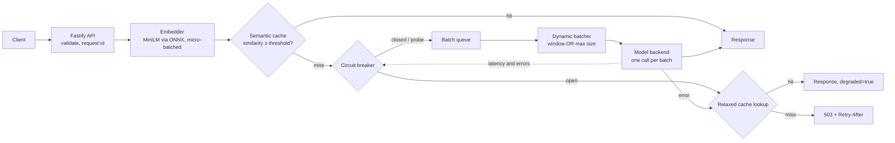
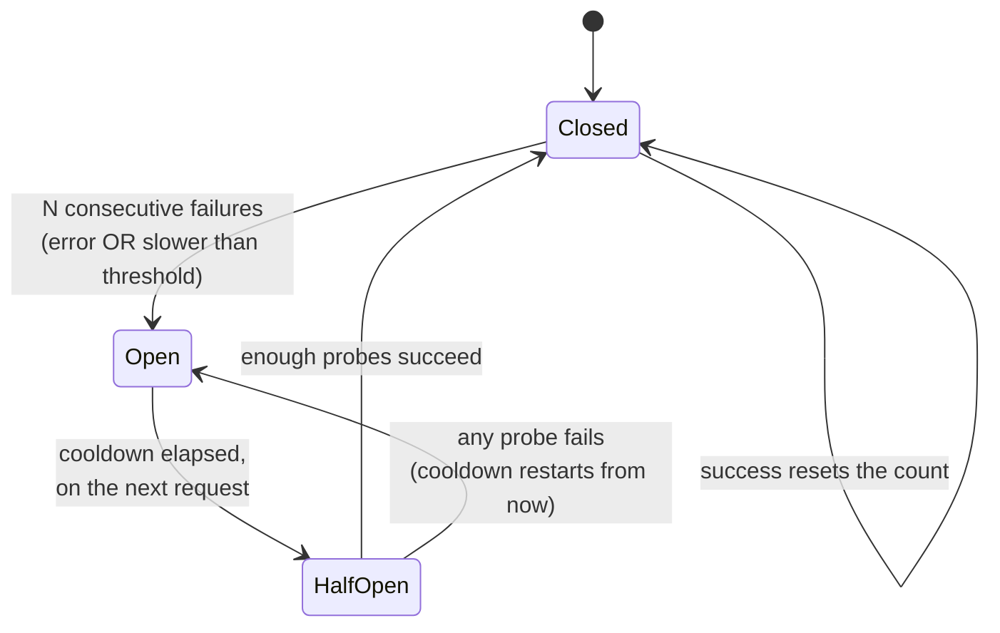

# Tachyon

A real-time inference serving layer, built from scratch in **Node.js and TypeScript**. It sits between clients and a model and handles the systems problems: **dynamic batching**, a **semantic cache**, a **circuit breaker** with graceful degradation, and **observability** good enough to debug an incident without reading the code.

No serving frameworks (no Triton, TorchServe or BentoML), no managed or hosted inference, no circuit-breaker library. The batcher, cache logic, breaker state machine and metrics aggregation are all hand-written. Commodity pieces are reused: Fastify for HTTP, `prom-client` for the exposition format, and Transformers.js to run HuggingFace models in-process.

**No Python, and no API keys.** The embedding model (MiniLM) and the optional real model (DistilBERT) are public HuggingFace models. Their weights are downloaded once and run inside the Node process through ONNX Runtime; nothing calls a hosted API.

**Headline numbers** (stub backend shaped like one GPU, measured on Node 22; details below):

| | Unbatched | Batched |
| --- | --- | --- |
| Throughput at 64 concurrent clients | 11.9 req/s | **125.4 req/s** (10.5×) |
| p99 at 100 req/s offered load | 59,399 ms, 22 timeouts | **320 ms** |
| Cache hit, server-side p50 | | **0.085 ms** vs 118 ms on the batched model path |
| Resident memory, stub backend | | **78 MB** |

---

## Contents

1. [Run it](#run-it)
2. [Architecture](#architecture)
3. [Dynamic batching, with numbers](#dynamic-batching)
4. [Semantic cache, and whether it is actually semantic](#semantic-cache)
5. [Circuit breaker and degradation](#circuit-breaker)
6. [Observability, and debugging an incident with it](#observability)
7. [Cache staleness vs inference cost](#staleness-vs-cost)
8. [API](#api)
9. [Tests](#tests)
10. [Limits](#limits)

---

## Run it

**Docker:**

```bash
docker compose up --build
```

Dashboard: http://localhost:3000 · API: http://localhost:8000 · Metrics: http://localhost:8000/metrics

The backend image downloads the MiniLM and DistilBERT weights at build time and bakes them in, so the container serves with no network access (`HF_HUB_OFFLINE=1`).

**Without Docker** (Node 20 or newer):

```bash
# backend
cd backend
npm ci
npm run dev                      # first start downloads MiniLM (~90 MB), progress is logged
EMBEDDER=hash npm run dev        # or: skip the download, lexical fallback only

# frontend, in a second terminal
cd frontend
npm ci
npm run dev                      # http://localhost:3000
```

The server starts listening immediately and loads the model in the background. Until it is ready, `/healthz` answers, `/readyz` returns 503 `warming`, and inference returns 503 `NOT_READY` with a `Retry-After`. If the download fails, the log says why and suggests `EMBEDDER=hash`.

Production build: `npm run build && npm start`. To serve a real model instead of the stub, set `MODEL_BACKEND=hf` (DistilBERT SST-2 sentiment by default; `HF_MODEL` and `HF_TASK` change it).

Every tunable is an environment variable (see [`backend/src/config.ts`](backend/src/config.ts)), and most are adjustable at runtime through `PATCH /v1/admin/config` or the dashboard.

---

## Architecture



**One Node process, one event loop, not clustered.** That is a decision, not a default: the batch queue and the cache must be shared by every request. Four cluster workers would mean four queues (batches a quarter the size) and four caches (a hit rate a quarter as good). Scale out with replicas instead.

The single event loop fits this workload, with one cost worth knowing. Waiting on the model, the queue and the network is asynchronous, and the ONNX forward passes run on ONNX Runtime's native threads, off the loop. The one heavy piece of synchronous work on the loop is the cache's similarity scan: **5.5 ms per lookup at 10,000 entries** on a 2.1 GHz cloud CPU (see [Semantic cache](#semantic-cache)). Event-loop delay is exported as a metric, so if the scan ever starts to hurt, it shows up on `/metrics`.

| Component | File | Hand-written |
| --- | --- | --- |
| Dynamic batcher (generic, used twice) | [`batcher.ts`](backend/src/batcher.ts) | yes |
| Semantic cache | [`semanticCache.ts`](backend/src/semanticCache.ts) | yes |
| Circuit breaker | [`circuitBreaker.ts`](backend/src/circuitBreaker.ts) | yes |
| Request lifecycle and degradation | [`service.ts`](backend/src/service.ts) | yes |
| Async primitives (semaphore, timed queue) | [`async.ts`](backend/src/async.ts) | yes |
| Metrics and logs | [`telemetry.ts`](backend/src/telemetry.ts) | aggregation yes, exposition format no |
| HTTP | [`app.ts`](backend/src/app.ts) | Fastify routes |
| Embedders, model backends | [`embedder.ts`](backend/src/embedder.ts), [`modelBackend.ts`](backend/src/modelBackend.ts) | wrappers |
| Dashboard | [`frontend/`](frontend) | Next.js, hand-drawn SVG charts |

Two ordering choices worth defending:

- **The cache is checked before the queue.** A hit never takes a queue slot or a batch position, so hits stay sub-millisecond under load and batches stay full of work that actually needs the model.
- **Embedding happens before the breaker check.** That costs time on requests the breaker will reject, but without a vector there is no cache fallback during an outage. The one exception: if the breaker will reject *and* the cache is empty, the embedding is skipped and the reject is near-instant.

---

## Dynamic batching

**How it works** ([`batcher.ts`](backend/src/batcher.ts)). Callers `await batcher.submit(item)` and get back their own result. Behind that, one background loop:

1. waits for a free device slot (`MODEL_CONCURRENCY`, 1 for a single GPU);
2. waits for the first queued request and **starts the window clock then**, not at loop entry (starting it early makes a request that arrives late in an idle window ship alone, which is the classic bug);
3. drains more requests until the batch reaches `MAX_BATCH_SIZE` **or** `BATCH_WINDOW_MS` elapses;
4. dispatches the batch as one backend call without awaiting it, and goes straight back to collecting.

Each pending request carries its own `resolve`/`reject`. Result *i* resolves caller *i*. If the backend returns the wrong number of results, every caller gets an error rather than somebody else's answer.

**Abandoned requests are not computed.** JavaScript promises cannot be cancelled, so a request whose client times out is marked abandoned, and the batcher skips it when forming the next batch.

**Waiting for a device slot *before* forming a batch is the subtle part.** While the device is busy, requests pile up in the queue, and the next batch is formed from that backlog at full size. Forming batches eagerly and parking them on the device lock would produce many small batches instead.

**Adaptive window.** At low load a fixed 50 ms window is pure added latency, because the batch never fills. The window scales with how full recent batches were (an exponentially weighted mean), from 5 ms under light traffic up to the full 50 ms under load.

**The stub models a GPU, on purpose.** A batch of *n* costs `80 ms + n × 3 ms ± 15 ms`, and only one batch runs at a time. That is the shape of real accelerator inference: a large fixed cost per forward pass and a small marginal cost per sequence. If the stub simply slept in parallel, unbatched requests would overlap for free and batching would show no gain, which would be a dishonest benchmark.

### Results

Same server, batching toggled through the admin API, cache disabled, a unique input per request so every request reaches the model. Reproduce with `npm run bench:load`.

**Closed loop:** N clients, each sends the next request as soon as the last returns. This measures throughput.

| Concurrent clients | Mode | Throughput (req/s) | p50 ms | p95 ms | p99 ms | Mean batch |
| --- | --- | --- | --- | --- | --- | --- |
| 1 | unbatched | 11.6 | 84.8 | 109 | 127 | 1 |
| 1 | batched | 10.8 | 93.9 | 112 | 114 | 1 |
| 4 | unbatched | 11.9 | 332 | 382 | 395 | 1 |
| 4 | batched | 33.4 | 118 | 143 | 150 | 4 |
| 16 | unbatched | 12.3 | 1,319 | 1,372 | 1,389 | 1 |
| 16 | batched | 113.3 | 141 | 170 | 181 | 16 |
| 64 | unbatched | 11.9 | 5,263 | 5,447 | 5,488 | 1 |
| 64 | batched | **125.4** | **514** | 556 | 560 | 16 |

| Concurrent clients | Throughput gain | p50 change | p99 change |
| --- | --- | --- | --- |
| 1 | 0.94× | **+11%** | −10% |
| 4 | 2.81× | −64% | −62% |
| 16 | 9.24× | −89% | −87% |
| 64 | 10.52× | −90% | −90% |

**Open loop:** requests arrive on a Poisson schedule at a fixed rate, whatever the server is doing. This is how real traffic behaves, and it is the honest test of latency under load, because an overloaded server cannot slow down its arrivals.

| Offered load | Mode | Served (req/s) | p50 ms | p99 ms | Mean batch | Errors |
| --- | --- | --- | --- | --- | --- | --- |
| 10 req/s | unbatched | 10.4 | 535 | 923 | 1 | 0 |
| 10 req/s | batched | 10.4 | 121 | 202 | 1.5 | 0 |
| 40 req/s | unbatched | 12.1 | 9,474 | 18,894 | 1 | 0 |
| 40 req/s | batched | 40.4 | 162 | 245 | 5.1 | 0 |
| 100 req/s | unbatched | 11.9 | 30,163 | 59,399 | 1 | 22 timed out |
| 100 req/s | batched | 102.8 | 208 | 320 | 15.2 | 0 |

_Measured on Linux x64, 2 CPUs, Node 22, 8 s per run. Raw data: [`backend/bench/results/batching.json`](backend/bench/results/batching.json)._

**Reading it.**

- **Batching does not reduce latency everywhere, and claiming it does would be wrong.** With one client there is nothing to batch with: p50 rises 11% (about 9 ms, the adaptive window's floor plus scheduling). A fixed 50 ms window would cost far more.
- **Under load it dominates,** because it amortises the 80 ms fixed cost across up to 16 requests. Unbatched serving caps at about 1 / 85 ms ≈ 12 req/s whatever the load. Batched serving approaches 16 / (80 + 16 × 3) ms = 125 req/s, and at 64 clients it measured **125.4**, every batch full at 16. The serving layer adds essentially nothing on top of the device's own limit.
- **The open-loop table is the one that matters for "latency under load".** At 40 req/s the unbatched server is over capacity, its queue grows without bound, and p99 reaches 19 seconds. The batched server serves the same traffic at 245 ms. That is not a 10% or 2× difference; it is the difference between a working system and a broken one.

---

## Semantic cache

**How it works** ([`semanticCache.ts`](backend/src/semanticCache.ts)):

- Embeddings are L2-normalised on insert, so cosine similarity is a plain dot product. All entries live in **one pre-allocated `Float32Array`** of `capacity × 384`, so a lookup is one tight loop over contiguous memory with no per-entry objects.
- **Top-k (k = 5), not top-1.** If the single nearest entry has expired, a valid second-best still hits instead of forcing a model call.
- **TTL** is checked lazily on read, plus a sweep every 60 s, so entries nobody asks for still free their slot.
- **LRU** uses a JavaScript `Map`, which iterates in insertion order: delete-and-reinsert moves an entry to the most-recent end, and the first key is the least recently used. Both are O(1). Eviction is by least recently *used*, not oldest inserted; there is a test for exactly that difference.
- Freed rows go on a min-heap and are reused lowest-first, so the scanned region stays compact.
- A near-identical insert (similarity ≥ 0.995) refreshes the existing entry instead of duplicating it. Otherwise concurrent misses for one question would fill the cache with copies.
- **Brute force, not HNSW**, deliberately, up to about 10,000 entries. Measured on a 2.1 GHz cloud vCPU:

  | Entries | Lookup | Insert, with the lookup's hint | Insert, full scan |
  | --- | --- | --- | --- |
  | 1,000 | 0.57 ms | 0.025 ms | 0.60 ms |
  | 10,000 | 5.5 ms | 0.025 ms | 5.5 ms |
  | 50,000 | 44 ms | 0.021 ms | 29 ms |

  **This is the one place Node is clearly slower than the Python version.** JavaScript has no SIMD, so the scan runs at roughly the speed of a plain loop; the floor on that CPU is about 4.6 ms, and this implementation is within 20% of it. numpy hands the same scan to BLAS and did it in about 1.5 ms. The scan runs on the event loop, so at 100 req/s it uses about half a CPU core. Past 10,000 entries the right move is a worker thread, WebAssembly SIMD, or an HNSW index.
- **Insert does not scan again.** Deduplication needs the nearest existing row, and a full scan per insert would double the cost of every miss. Instead the lookup records a write sequence number, and the insert checks only the rows written since then: usually a handful, and exactly the concurrent misses for the same question that deduplication exists to catch. That is the 220× difference in the table. If the write log has rolled past the lookup, the insert falls back to a full scan.

**Metrics reported:** hit rate, average similarity of hits, inference calls saved, and estimated waiting time saved (calls saved × recent mean model-path latency). Degraded serves during outages are counted separately, so an outage does not count each request twice.

### Is it actually semantic?

That depends on the embedder, and the repository is built to show the difference rather than hide it.

**With MiniLM (the default)**, paraphrases with little shared vocabulary land close together. That is what [`test/semanticMinilm.test.ts`](backend/test/semanticMinilm.test.ts) checks, against [16 paraphrase pairs and 12 hard negatives](backend/src/labelledPairs.ts). The negatives are deliberately nasty: same sentence, different subject ("capital of France" vs "capital of Germany", "HTTP 404" vs "HTTP 500").

> **Run these yourself.** The build environment could not download model weights, so the MiniLM tests and the MiniLM threshold sweep have not been run. Without the weights they skip cleanly. Run them before quoting numbers:
>
> ```bash
> cd backend
> npm run test:minilm
> npm run bench:sweep
> ```
>
> The sweep prints, for each threshold, the share of paraphrases that hit and the share of different questions that wrongly hit. Set `CACHE_THRESHOLD` from that table. 0.92 ships as a conservative default, because a wrong answer costs more than a missed hit.

**With the offline `hash` embedder** (used by the test suite) the cache is *lexical*: it matches rewordings that share content words and nothing else. Measured on the same labelled pairs:

| Threshold | Paraphrases that hit | Different questions that wrongly hit |
| --- | --- | --- |
| 0.70 | 25% | 8% |
| 0.80 | 25% | 0% |
| 0.92 | **0%** | 0% |

It fails the semantic test outright, which is exactly why it is not the default. "What are the symptoms of dehydration?" vs "How can I tell if I am dehydrated?" scores 0.01.

**Live correctness check.** `npm run bench:cache` sends Zipf-skewed traffic over 30 topics × 7 phrasings. Every response carries the text that produced it, so each hit can be judged: did the user get the answer to *their* question, or a neighbour's? With the hash embedder at 0.92: **93.8% hit rate, 0 wrong answers in 1,407 hits.** "Capital of France" was never served for "capital of Germany". The hit rate is flattered by templated phrasings that share every content word, so read it as a test of the false-positive guard, not of semantic recall. Rerun it with MiniLM for the meaningful number.

---

## Circuit breaker



Hand-written in [`circuitBreaker.ts`](backend/src/circuitBreaker.ts). The details implementations usually get wrong, each with a test:

- **Consecutive, not cumulative.** One success resets the failure count. A cumulative counter would eventually trip a healthy backend that has occasional errors.
- **Slow counts as failed.** A backend answering everything in 30 s has a 0% error rate and is useless. Responses slower than `BREAKER_LATENCY_THRESHOLD_MS` count as failures.
- **One batch is one observation.** A failed batch of 16 is one failure, not 16. Counting per request would let a single bad batch trip the breaker on its own and tie the threshold to the batch size.
- **Half-open admits a bounded number of probes (3), not a percentage.** At 1,000 req/s, "10% of traffic" is 100 requests against a backend that may still be down.
- **A failed probe restarts the cooldown from the failure,** not from the original trip, so a sick backend is not re-probed immediately.
- **Stale results cannot decide a probe.** Every transition bumps a generation counter, and each admitted request carries a permit stamped with it. A slow request admitted while *closed* can finish after the breaker has gone open and then half-open. Without the stamp its success would be read as a probe verdict, and could close the circuit on evidence from before the outage.
- **Leaked probes are returned.** If a probe's client times out, its slot is released. Otherwise half-open would sit with every slot used and no verdict coming, rejecting forever.

### Degradation ladder

When the model cannot answer (breaker open, backend error, batch timeout), the request goes down this ladder instead of straight to an error:

1. **Normal cache hit:** served before the breaker is consulted at all.
2. **Relaxed cache hit** at `CACHE_DEGRADED_THRESHOLD` (0.82): returned with `"degraded": true`, the similarity and the matched query, so the client can decide whether an approximate answer is acceptable.
3. **503 `CIRCUIT_OPEN`** with a `Retry-After` taken from the real remaining cooldown.

A client that sent `"cache": false` asked for freshness explicitly, so it gets the error rather than a stale answer.

### Measured outage

`npm run bench:breaker`: 30 req/s, 60% popular (cacheable) questions, 40% never seen before. The backend fails at t = 3 s and recovers at t = 12 s.

| Seconds | Model | Cache | Model error | Rejected fast |
| --- | --- | --- | --- | --- |
| 0–2 | 36 | 53 | 0 | 0 |
| 3 | 0 | 23 | **6** | 3 |
| 4–11 | 0 | 142 | 4 | **84** |
| 12–15 | 0 | 73 | 0 | 39 |
| 16–19 | 55 | 83 | 0 | 0 |

```
16:48:21.458     closed -> open       5 consecutive failures
16:48:25.543       open -> half_open  cooldown elapsed
16:48:25.647  half_open -> open       probe failed          <- backend still down: correctly re-opened
16:48:29.692       open -> half_open  cooldown elapsed
16:48:29.787  half_open -> open       probe failed          <- 0.2 s before the backend recovered
16:48:33.850       open -> half_open  cooldown elapsed
16:48:34.043  half_open -> closed     3 probes succeeded
```

Through the whole outage, popular questions kept being answered from cache without interruption. New questions got an immediate 503 instead of hanging. Only 10 requests ever reached the broken backend.

The rows for seconds 12–15 show the cost of the design: the backend was healthy again, but the breaker stayed open for about 4 more seconds. Its last probe landed just *before* the recovery, failed, and correctly restarted the cooldown. **Recovery lags by at most one cooldown.** That is the price of not flooding a backend that might still be down, and the reason the cooldown is tunable.

---

## Observability

### `/metrics` (Prometheus)

| Metric | Answers |
| --- | --- |
| `tachyon_request_rate_per_second` | Is traffic arriving? |
| `tachyon_latency_ms{scope, quantile}` | Exact p50/p95/p99 over the last 60 s, for `total`, `model`, `queue`, `embed`, `cache_hit`, `model_path` |
| `tachyon_request_duration_seconds` / `tachyon_model_duration_seconds` | The same as histograms, which aggregate across replicas |
| `tachyon_queue_wait_seconds`, `tachyon_queue_depth` | Is the queue backing up? |
| `tachyon_batch_size` (histogram), `tachyon_batches_total{reason}` | Is batching batching? Do batches fill, or does the window close first? |
| `tachyon_cache_hit_rate`, `tachyon_cache_avg_hit_similarity`, `tachyon_cache_estimated_inference_calls_saved` | Is the cache working, and how confident are its hits? |
| `tachyon_circuit_state{state}`, `tachyon_circuit_trips_total`, `tachyon_circuit_consecutive_failures` | Is the backend healthy? How close is the breaker to tripping? |
| `tachyon_model_errors_total{kind}` | Why is it failing: exception, timeout, or slow? |
| `tachyon_load_shed_total{reason}` | Is load being shed, and why? |
| `tachyon_nodejs_eventloop_lag_p99_seconds`, `tachyon_process_resident_memory_bytes` | Is the event loop blocked? Is memory growing? |

Latency is measured two ways, on purpose. Prometheus histograms aggregate correctly across replicas, but any percentile derived from them is only as precise as the bucket edges. The `tachyon_latency_ms` gauges are exact, computed from raw samples in a time-windowed ring buffer, but local to one process. The hot path only writes into a ring buffer; sorting happens when someone scrapes.

**Model latency is reported separately from total latency.** That split locates a slowdown: total ≫ model means the time is going into queueing, while total ≈ model means the model itself is slow.

### Structured logs

One JSON line per request on stdout:

```json
{"seq":3,"ts":"2026-10-12T16:39:05.364Z","level":"info","event":"request",
 "request_id":"6fd61ec5-9c69-46a0-964f-69beb572c685","batch_id":"72dee556c37b","batch_size":1,
 "cache":"miss","similarity":null,"best_miss_similarity":null,"cache_age_s":null,
 "degraded":false,"degraded_reason":null,"circuit_state":"closed","probe":false,
 "source":"model","embed_ms":0.389,"cache_lookup_ms":0.306,"queue_wait_ms":6.436,
 "model_latency_ms":106.362,"total_latency_ms":115.164,"status":200,"error":null,
 "input_sha256":"64ad73596b106539","input_chars":15,"input_preview":"What is Python?",
 "matched_query":null}
```

There is also one line per **batch** (size, dispatch reason, queue waits, model latency, outcome), one per **circuit transition** (with its reason), and one per config change or injected fault. `batch_id` joins a request to its batch, so a single slow batch can be told apart from a general slowdown. On a miss, `best_miss_similarity` shows how close the nearest cached entry was, which is the evidence you need to tune the threshold. Input previews can be turned off with `LOG_INPUTS=false`.

### Debugging an incident with only metrics and logs

> *p99 latency doubled at 14:03. Nobody has read the code.*

| Look at | You see | It means |
| --- | --- | --- |
| `tachyon_nodejs_eventloop_lag_p99_seconds` | flat, a few ms | The process is not blocked. Rule this out first in a single-threaded server. |
| `tachyon_latency_ms{scope="total"}` vs `{scope="model"}` | total p99 up, model p99 flat | The model is fine. The time is going in front of it. |
| `{scope="queue"}`, `tachyon_queue_depth` | queue p99 up, depth climbing | Requests are waiting for capacity. |
| `tachyon_batch_size`, `tachyon_batches_total{reason}` | batches pinned at max, every dispatch `full` | The batcher is saturated, not misconfigured. A wider window would not help. |
| `tachyon_cache_hit_rate` over time | fell from 60% to 15% at 14:02 | Traffic shifted to new questions; the cache stopped absorbing load. |
| `tachyon_circuit_state`, `tachyon_model_errors_total` | closed, no errors | Not a failure: a capacity event. |
| logs: `event=request, cache=miss` around 14:02 | `best_miss_similarity` mostly below 0.5 | Genuinely new questions, not a threshold that is too strict. |

**Conclusion, without opening the code:** a shift in what users asked broke cache locality. Every request became a model call, the batcher saturated, and queue wait absorbed the difference. **Fix:** add a replica or a bigger device. Changing the batch window or the cache threshold would not help.

The opposite case reads differently. Model p99 up, total tracking it, `model_errors_total{kind="slow"}` rising and the breaker's consecutive failures climbing means the backend itself is degrading. The breaker will trip at the threshold, and the logs will carry a `circuit_transition` line with the reason.

---

## Staleness vs cost

Every cache hit trades freshness for cost. A hit saves a model call (device time, about 100 ms of latency, money on a hosted model). It also serves an answer computed at some point in the past, and a semantic cache makes this sharper than an exact-match cache: a hit can be wrong for two independent reasons. **It is old**, and **it was not quite the same question**. The threshold controls the second; the TTL controls the first.

### Measuring the TTL trade-off

`npm run bench:staleness` runs the production cache class against four simulated hours of traffic: 20 req/s, 500 Zipf-popular topics, each topic's true answer changing at random on average every 10 minutes (think prices, stock levels, status pages). A hit is *stale* if the answer changed after it was cached.

| TTL | Hit rate | Model calls per 1k requests | Hits that were stale | Stale answers per 1k requests |
| --- | --- | --- | --- | --- |
| 5 s | 54.7% | 453 | 0.4% | 2 |
| 30 s | 75.7% | 243 | 2.1% | 16 |
| 1 min | 82.5% | 175 | 4.3% | 35 |
| 5 min | 93.8% | 62 | **19.4%** | 182 |
| 15 min | 97.5% | 25 | 46.2% | 450 |
| 60 min | 99.3% | 7 | 80.6% | 801 |

Two things fall out of this.

**Hit rate saturates; staleness does not.** Going from a 1-minute to a 5-minute TTL saves another 113 model calls per thousand requests, but serves 147 more wrong answers per thousand. Past a point you are buying very little inference with a lot of incorrectness.

**There is a rule of thumb behind the numbers.** Under steady traffic, a hit's age is spread roughly evenly over the TTL, so its mean age is about TTL / 2. If answers change on average every *L* seconds, the chance a hit is stale is roughly (TTL / 2) / *L*. That predicts 5% at a 1-minute TTL (measured 4.3%) and 25% at 5 minutes (measured 19.4%), so it errs slightly on the safe side. Inverted:

> **TTL ≈ 2 × answer lifetime × the stale rate you can tolerate.**

If answers change every 10 minutes and you can accept 5% stale hits, the TTL is about a minute.

### My position

The right TTL and threshold are not constants. They are functions of **what a wrong answer costs in that domain**, and the serving layer should make that choice explicit rather than bake in one global value.

- **Defaults here: TTL 5 min, threshold 0.92.** This project serves a stateless model, where the truth behind an input does not change, so the TTL exists only to bound memory and to pick up model updates. Five minutes is generous for that. The 0.92 threshold is conservative because a semantic false positive is a confidently wrong answer, which is worse than a miss.
- **For time-sensitive or personalised answers I would cut the TTL to the 30–60 s range** (using the rule above with the real change rate), raise the threshold, and accept the lower hit rate as the price of correctness.
- **Clients who know better can override per request.** `"cache": false` forces a fresh answer, which then refreshes the cache for everyone else; `cache_threshold` raises the bar for one call. A global TTL is the wrong tool for a decision only the caller can make.
- **Degraded serving changes the calculation.** During an outage the alternative to a stale answer is no answer, so the relaxed threshold (0.82) is acceptable there, but only because the response says `degraded: true` and discloses the similarity.

What I would add in production: a TTL per *kind* of request rather than one global value, and **event-driven invalidation** (drop entries when the underlying data changes), which removes staleness instead of trading against it.

---

## API

| Method | Path | Purpose |
| --- | --- | --- |
| POST | `/v1/infer` | One inference request. Batching is invisible to the client. |
| POST | `/v1/infer/batch` | Up to 256 inputs; each goes through the full pipeline. |
| GET | `/metrics` | Prometheus exposition |
| GET | `/healthz`, `/readyz` | Liveness, and readiness (503 while models load) |
| GET | `/v1/stats` | JSON snapshot used by the dashboard and the benchmarks |
| GET | `/v1/stream` | Server-sent events: stats plus new log lines every second |
| GET | `/v1/logs/recent` | Recent log lines; filter by `event`, `request_id`, `batch_id` |
| GET / PATCH | `/v1/admin/config` | Read or change tunables at runtime (range-checked, all-or-nothing) |
| GET / DELETE | `/v1/admin/cache` | Cache stats and recent entries, or flush |
| GET | `/v1/admin/circuit` | Breaker state and transition history |
| POST | `/v1/admin/circuit/reset` | Force closed |
| POST | `/v1/admin/backend/fault` | Inject `error`, `slow`, or `flaky` faults into the stub |

```bash
curl -s localhost:8000/v1/infer -H 'content-type: application/json' -d '{"input":"What is Python?"}'
curl -s localhost:8000/v1/infer -H 'content-type: application/json' -d '{"input":"Tell me about Python"}'
```

The second call, as returned by the server (hash embedder):

```json
{"request_id":"…","output":{"label":"NEGATIVE","score":0.6067,"input_sha256":"64ad73596b106539",
 "echo":"What is Python?"},"cached":true,"degraded":false,"degraded_reason":null,"source":"cache",
 "similarity":1,"matched_query":"What is Python?","batch_id":null,"circuit_state":"closed",
 "model_latency_ms":null,"total_latency_ms":0.405,"timings_ms":{…}}
```

Errors share one shape and carry a machine-readable code (`INVALID_REQUEST` 400, `QUEUE_FULL` 429, `CIRCUIT_OPEN` 503, `MODEL_ERROR` 502, `MODEL_TIMEOUT` / `REQUEST_TIMEOUT` 504), with `Retry-After` where retrying makes sense. Clients can send `X-Request-ID`; it is echoed back and used in every log line.

---

## Tests

```bash
cd backend
npm test                 # 67 tests, ~6 s, offline
npm run test:minilm      # semantic tests, downloads the MiniLM weights
```

| File | What it proves |
| --- | --- |
| `batcher.test.ts` (17) | Per-request correlation across 200 concurrent callers; full batches dispatch before the window; the window starts at the first item; backlog forms full batches; failures reach every caller; a result-count mismatch errors instead of misrouting; queue-full sheds; abandoned requests are skipped; graceful stop drains |
| `circuitBreaker.test.ts` (17) | Every transition; consecutive vs cumulative; slow trips; a batch counts once; bounded probes; probe failure restarts the cooldown; stale results ignored; leaked probes released |
| `semanticCache.test.ts` (19) | Threshold edges; non-exact matching; top-k past an expired neighbour; TTL; LRU by use, not insertion; capacity under churn; dedupe, including the incremental check catching a concurrent insert, ignoring a reused slot, and falling back to a full scan; accounting during degradation |
| `service.test.ts` (14) | End to end through the pipeline and HTTP: batching plus routing, cache hits skip the model, degraded serving on open circuit and on model error, fast reject skips embedding, bypass clients get errors not stale answers, recovery through half-open, 429, timeout releases the probe, log schema, `/metrics` validity |

The suite passed five runs in a row (some batcher tests depend on timing, so this was checked). Graceful shutdown was also checked by hand: 20 requests in flight when `SIGTERM` arrived, all 20 answered with 200, then a clean exit.

---

## Limits

Said plainly:

- **The similarity scan is the main CPU cost** (5.5 ms per lookup at 10,000 entries, on the event loop). Fine for this capacity; beyond it, move the scan off the loop (worker thread or WebAssembly SIMD) or use HNSW.
- **One process.** The cache is in-process, so a second replica gets its own cache, and the hit rate drops roughly in proportion. The next step is a shared vector cache (Redis with vector search). Its ~1 ms round trip is worth paying once there is more than one replica, and not before.
- **The benchmarks use the stub.** It is shaped like a GPU (fixed cost plus per-item cost, one batch at a time), and the numbers follow from that shape. With `MODEL_BACKEND=hf` the gain depends on how well the real model batches on your hardware; rerun `npm run bench:load` to measure it.
- **Not yet run in the build environment:** the MiniLM semantic tests and threshold sweep (model weights could not be downloaded there), and `docker compose up` (no Docker daemon). Everything else in this README was run, and the numbers are measured.
- **The Docker image is large on disk** because `onnxruntime-node` ships native binaries (about 540 MB). Runtime memory is small.
- No auth on the admin API, no streaming responses, no token-level continuous batching. Those belong to a generative-model server, and this layer is model-agnostic.
